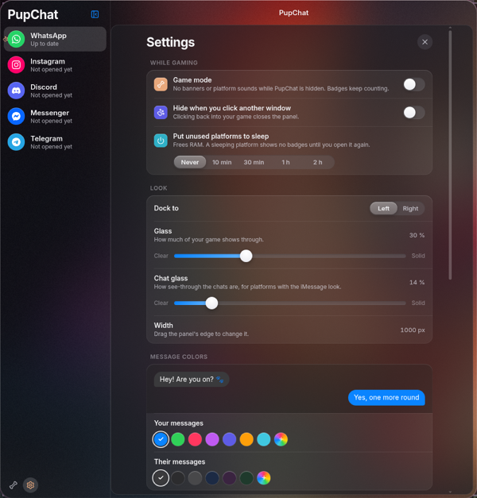
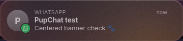

<p align="center">
  
</p>

<h1 align="center">PupChat</h1>

<p align="center">
  <b>Your chats in one liquid-glass panel you open with a hotkey while gaming.</b><br>
  WhatsApp · Instagram · Discord · Messenger · Telegram — iMessage-style, with a little puppy.
</p>

<p align="center">
  
  
  
  
</p>

---

No more alt-tabbing out of your game to answer a message. Press a hotkey (or click the little
glass paw on the screen edge), and PupChat slides in over your game with all your chats. Press
it again and you're back in the game, with focus right where it was.

<p align="center">
  
</p>

## Features

- **All your chats in one panel** — the official web apps of WhatsApp, Instagram DMs, Discord,
  Messenger and Telegram, each in its own isolated, persistent session. Logins survive restarts.
- **Liquid glass** — a frosted, see-through panel (compositor blur on Hyprland, acrylic on
  Windows 11) with a glass slider for how much of your game shows through.
- **iMessage look (optional, per platform)** — blue and gray bubbles, see-through glass chats with
  their own *Chat glass* slider, pill-shaped inputs, round send buttons. Pick your own bubble colors,
  globally or per platform. CSS only.
- **The paw** — a small glass paw on the edge of the monitor you're using. One click opens
  PupChat, the next click slides it away. It shows your total unread count.
- **iMessage-style banners** — notifications slide in at the top center of the screen; click to
  open that chat. Game mode silences banners and sounds while keeping badges.
- **Unread badges** from page titles (no message content is ever read).
- **Made for gaming** — hide on blur, sleep unused platforms to save RAM, per-platform mute,
  zoom per platform (`Ctrl` `+`/`-`/`0`), `Ctrl+1…5` to switch, `Ctrl+Shift+B` to collapse the list.
- **Your choice of side** — dock left or right, drag the edge to resize, everything remembered.
- **Your Discord theme** — import the themes you use in Equicord/Vencord (theme links, local themes,
  Quick CSS) with one click. Themes only: plugins run code inside Discord and aren't supported.

<p align="center">
  
</p>

## Install

### Arch / EndeavourOS
Download the AppImage from [Releases](https://github.com/AriCuteGirl/pupchat/releases), or build it:

```bash
git clone https://github.com/AriCuteGirl/pupchat && cd pupchat
pnpm install
pnpm dist:linux      # → dist/PupChat-<version>-x86_64.AppImage
```

### Windows 10 / 11
Download `PupChat-Setup-<version>.exe` from [Releases](https://github.com/AriCuteGirl/pupchat/releases)
or build it with `pnpm dist:win`.

### Run from source
```bash
pnpm install
pnpm start
```

## Hyprland setup

PupChat runs as a native Wayland app. The hotkey belongs to Hyprland: the panel lives on its own
special workspace, so showing and hiding it is instant and focus goes back to your game by itself.
Add this to your config (Lua config, Hyprland 0.57+; tested on 0.57.2):

```lua
-- Show/hide PupChat with Super + \ (by key position, works on every layout)
hl.bind("SUPER + code:51", hl.dsp.workspace.toggle_special("pupchat"),
    { description = "PupChat: Toggle chat panel" })

-- The panel lives on its own special workspace; PupChat docks itself to the screen edge
hl.window_rule({ match = { class = "^(pupchat)$", title = "^(PupChat)$" }, workspace = "special:pupchat silent", float = true, border_size = 0, rounding = 26 })
-- The paw: on every workspace, clickable, never grabs focus when it appears
hl.window_rule({ match = { class = "^(pupchat)$", title = "^(PupChat Paw)$" }, float = true, pin = true, size = { 56, 56 }, no_initial_focus = true, border_size = 0, no_shadow = true, rounding = 28 })
-- Notification banners
hl.window_rule({ match = { class = "^(pupchat)$", title = "^(PupChat Banner)$" }, float = true, pin = true, no_initial_focus = true, border_size = 0, rounding = 22 })
```

Without these rules PupChat still works as a normal window (`pupchat --toggle`).

**Good to know**
- The panel opens over fullscreen games. With [Quickshell](https://quickshell.org) installed, the
  paw is a Wayland overlay layer and stays visible over fullscreen games too (PupChat starts it
  itself, no config needed). Banners show over borderless or windowed games.
- The glass blur comes from Hyprland's `decoration:blur`. Turn the glass up in Settings if your
  blur is off.

## Command line

A second launch talks to the running PupChat — handy for launchers and keybinds:

```
pupchat --toggle | --show | --hide | --settings | --quit
pupchat --service=discord        # open on a platform
```

## Windows notes

- Default shortcut **Ctrl+Shift+Space** (change it in Settings).
- Windows 11 22H2+ gets real acrylic glass; Windows 10 gets PupChat's own translucent glass.
- **Exclusive-fullscreen games cover every window**, PupChat included. Switch the game to
  *borderless* or *windowed fullscreen* to use PupChat on top of it.

## Privacy and safety

- **Official web apps only.** No unofficial APIs, no scraping, no automation, no client mods.
- **No message content is read.** Badges come from page titles; banners show the sites' own
  notifications and are never stored. The optional iMessage look is CSS only.
- **Logins stay on your machine**, one isolated session per platform. No telemetry, no calls
  anywhere except the platforms themselves.
- Microphone and camera are off unless you allow them per platform. Screen sharing, location and
  other permissions are denied.
- **Anticheat-safe:** PupChat is a separate window. It never touches game processes, never hooks
  DirectX/Vulkan and never reads game memory.

## Credits

- Service logos: [Simple Icons](https://simpleicons.org) (CC0), used unmodified.
- UI icons: [Lucide](https://lucide.dev) (ISC).
- Font: [Inter](https://rsms.me/inter/) (SIL OFL 1.1, see `resources/fonts/Inter-OFL.txt`).
- Built with Electron, Svelte 5 and electron-vite. Made with help from Claude.

PupChat isn't affiliated with Meta, Discord or Telegram. All trademarks belong to their owners.

## License

[MIT](LICENSE) © 2026 AriCuteGirl
